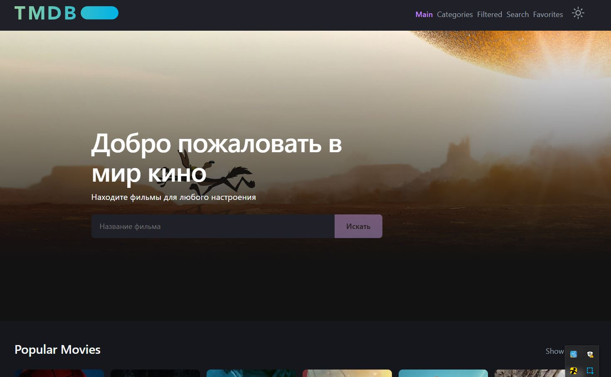
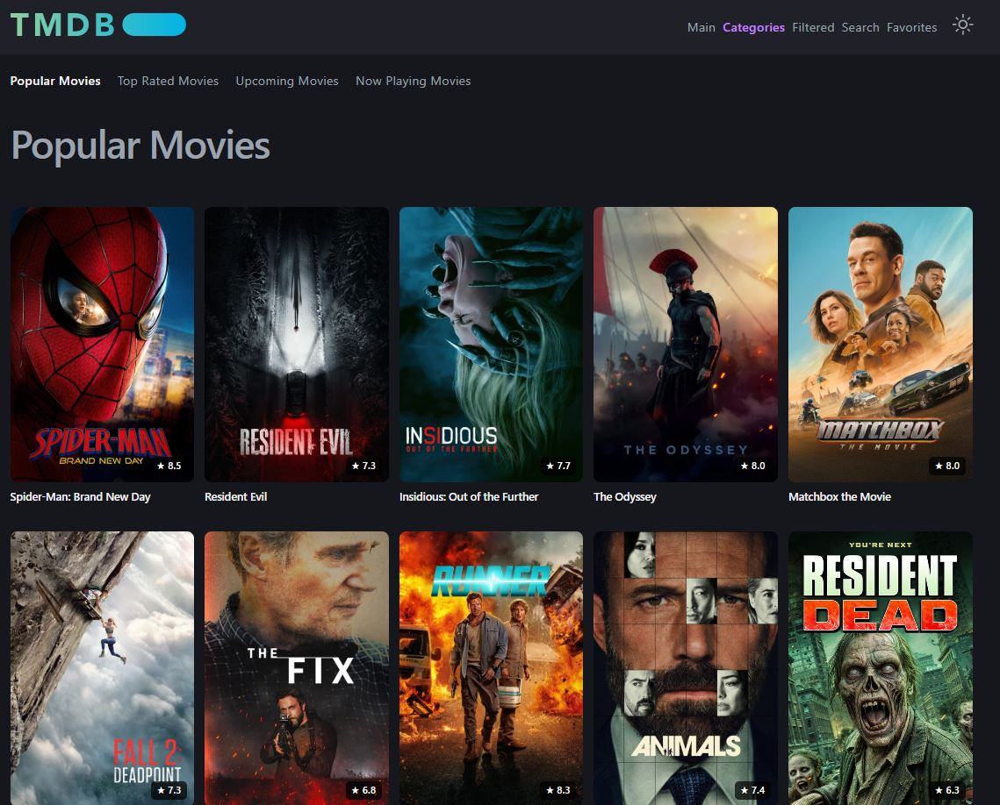
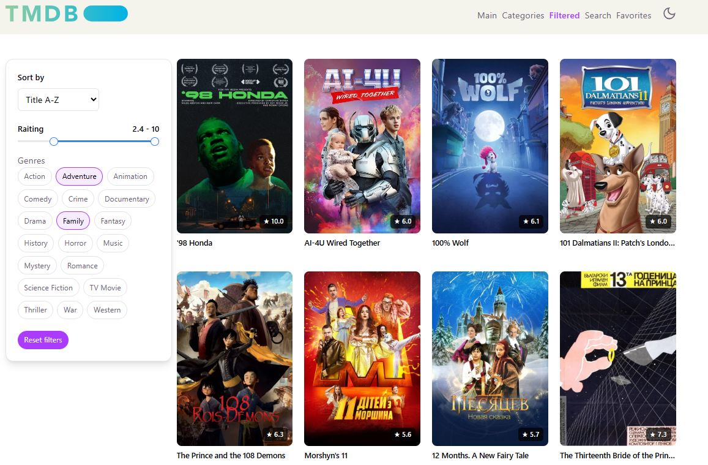
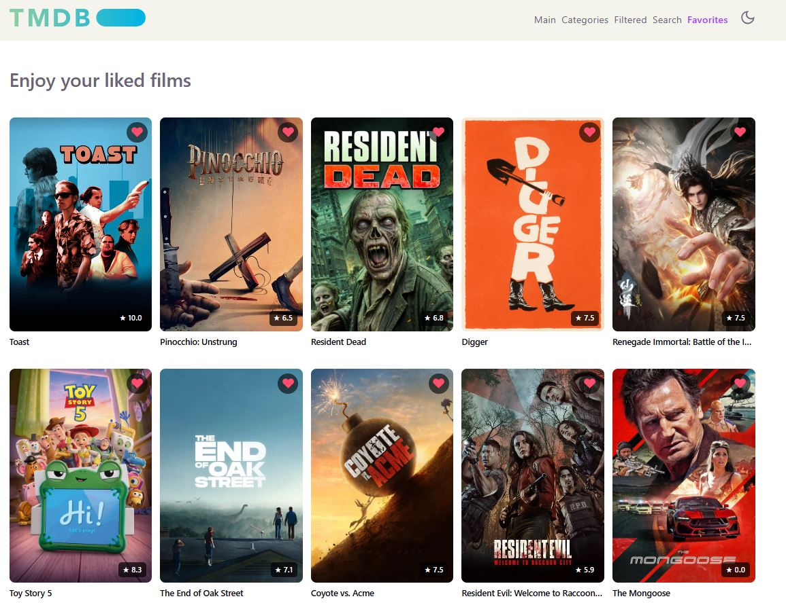

# FFY — Movie Streaming & Discovery App

FFY — это веб-приложение для поиска, фильтрации фильмов. Приложение использует API [The Movie Database (TMDB)](https://www.themoviedb.org/) для получения данных о фильмах, актерах, жанрах и позволяет пользователям сохранять избранные фильмы.

**[🔗 Посмотреть демо](https://ffy-lyart.vercel.app/)**

---

## 📸 Скриншоты приложения

### Главная страница


### Поиск фильмов


### Фильтрация и сортировка


### Избранные фильмы


## 🚀 Основные возможности

- **Главная страница** — герой-секция со случайным фильмом, поиск и категории фильмов
- **Поиск фильмов** — поиск по названию с бесконечной прокруткой
- **Категории** — Popular, Top Rated, Upcoming, Now Playing с пагинацией
- **Фильтры и сортировка** — по рейтингу, дате, популярности, названию и жанру
- **Избранное** — сохранение и просмотр любимых фильмов (сохраняется в localStorage)
- **Детальная страница фильма** — информация, актеры, похожие фильмы
- **Темная/светлая тема** — переключение с сохранением в localStorage
- **Адаптивный дизайн** — корректное отображение на всех устройствах

---

## 🛠 Технологический стек

| Слой                 | Технология                                                                                           |
| -------------------- | ---------------------------------------------------------------------------------------------------- |
| **Фреймворк**        | [React 19](https://react.dev/) с JSX transform                                                       |
| **Язык**             | [TypeScript 6.0](https://www.typescriptlang.org/) (ES2023)                                           |
| **Сборщик**          | [Vite 8.3](https://vitejs.dev/) + `@vitejs/plugin-react`                                             |
| **State Management** | [Redux Toolkit 2.13](https://redux-toolkit.js.org/) + [React Redux 9.3](https://react-redux.js.org/) |
| **Data Fetching**    | [RTK Query](https://redux-toolkit.js.org/rtk-query/overview)                                         |
| **Роутинг**          | [React Router DOM 7.1](https://reactrouter.com/)                                                     |
| **Валидация**        | [Zod 4.6](https://zod.dev/) (runtime валидация API ответов)                                          |
| **Уведомления**      | [React Toastify 11](https://github.com/fkhadra/react-toastify)                                       |
| **Стилизация**       | CSS Modules, CSS custom properties для темизации                                                     |
| **Иконки**           | SVG sprite + кастомный компонент `<Icon>`                                                            |
| **Линтинг**          | ESLint 10 + TypeScript ESLint + React Hooks plugin                                                   |
| **Форматирование**   | [Prettier 3.9](https://prettier.io/)                                                                 |
| **Деплой**           | [Vercel](https://vercel.com/) (SPA fallback)                                                         |

---

## 📁 Структура проекта

Проект построен по методологии **Feature-Sliced Design (FSD)**:

```
src/
├── app/                  # Уровень приложения
│   ├── lib/              # Настройки: store, slices, path
│   └── ui/               # Корневой компонент App
├── pages/                # Страницы приложения
│   ├── Main/             # Главная страница
│   ├── Search/           # Поиск фильмов
│   ├── Favorites/        # Избранное
│   ├── Filtered/         # Фильтры и сортировка
│   ├── Categories/       # Категории (Popular, Top Rated и т.д.)
│   ├── DetailsMovie/     # Детальная страница фильма
│   └── NotFound/         # 404 страница
├── features/             # Функциональные блоки
│   └── searchMovie/      # Компонент поиска
├── widgets/              # Композитные виджеты
│   ├── ListMovies/       # Сетка фильмов
│   ├── ListMovieSceleton/# Скелетон загрузки
│   ├── Casts/            # Актеры фильма
│   ├── SimilarFilms/     # Похожие фильмы
│   └── FiltersForm/      # Форма фильтров
├── entities/             # Сущности
│   ├── Movie/            # Модель фильма, API, UI компонент
│   ├── Credits/          # Актеры и команда
│   └── User/             # Сущность пользователя (избранное)
└── shared/               # Переиспользуемые модули
    ├── lib/              # Утилиты, хуки, API, константы
    └── ui/               # Базовые UI компоненты (Header, Footer)
```

---

## 🗺 Маршруты

| Маршрут             | Описание                                              |
| ------------------- | ----------------------------------------------------- |
| `/`                 | Главная страница с героем, поиском и категориями      |
| `/search?query=...` | Поиск фильмов по запросу                              |
| `/favorites`        | Избранные фильмы пользователя                         |
| `/filtered`         | Фильтрация и сортировка фильмов                       |
| `/movies/:category` | Категории (popular, top_rated, upcoming, now_playing) |
| `/movie/:id`        | Детальная информация о фильме                         |
| `*`                 | Страница 404 (файл не найден)                         |

---

## ⚙️ Переменные окружения

Проект использует следующие переменные окружения (`.env`):

| Переменная            | Описание                  | Пример                          |
| --------------------- | ------------------------- | ------------------------------- |
| `VITE_API_KEY`        | TMDB API key              | `abc123...`                     |
| `VITE_API_ACCESS_KEY` | JWT Bearer токен для TMDB | `eyJ...`                        |
| `VITE_BASE_URL`       | Базовый URL TMDB API      | `https://api.themoviedb.org/3/` |

> ⚠️ Файл `.env` не включен в репозиторий. Создайте его на основе `.env.example` и добавьте свои API ключи.

---

## 🚦 Быстрый старт

### Требования

- [Node.js](https://nodejs.org/) 18+
- [pnpm](https://pnpm.io/) (или npm/yarn)

### Установка

```bash
# 1. Клонируйте репозиторий
git clone <repository-url>
cd FFY

# 2. Установите зависимости
pnpm install

# 3. Создайте файл .env и добавьте TMDB API ключи
cp .env.example .env
# Отредактируйте .env и вставьте свои ключи

# 4. Запустите разработческий сервер
pnpm dev
```

## 🎨 Стилизация

Проект использует **CSS Modules** (`.module.css` файлы) для инкапсуляции стилей. Темизация реализуется через CSS custom properties и переключение класса `dark` на элементе `<html>`.

---

## 📦 Архитектура

### Redux Store

Хранилище состоит из трех слайсов:

- **`app`** — тема (`dark`/`light`) и глобальные ошибки
- **`user`** — избранные фильмы пользователя
- **`movieApi`** — RTK Query кэш для всех запросов к API

Данные избранного синхронизируются с `localStorage` при каждом изменении.

### Хуки

| Хук                | Описание                                          |
| ------------------ | ------------------------------------------------- |
| `useAppDispatch`   | Типизированный `dispatch` из Redux                |
| `useAppSelector`   | Типизированный `selector` из Redux                |
| `useGlobalLoading` | Показывает глобальную загрузку (спиннер в хедере) |
| `useDebounceValue` | Debounce для значений (по умолчанию 700мс)        |

### Утилиты

| Утилита        | Описание                                                          |
| -------------- | ----------------------------------------------------------------- |
| `handleErrors` | Отображает toast-уведомления при ошибках API (404, 401, 429, 5xx) |
| `getDuration`  | Форматирует длительность фильма (90 мин → `1h 30min`)             |
| `getGenres`    | Объединяет массив жанров в строку                                 |

---

## 🌐 Деплой

Проект настроен для деплоя на **Vercel**. Конфигурация в `vercel.json` обеспечивает корректную работу SPA (все маршруты перенаправляются на `/`).
